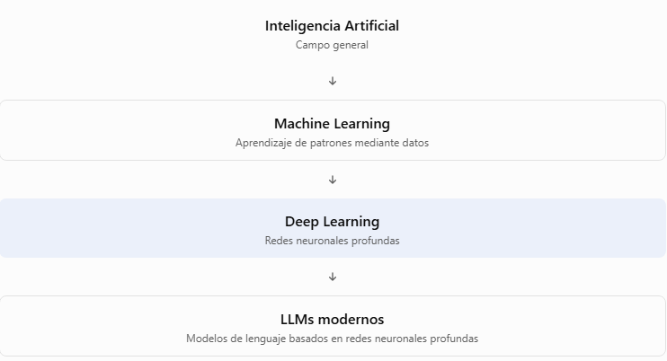
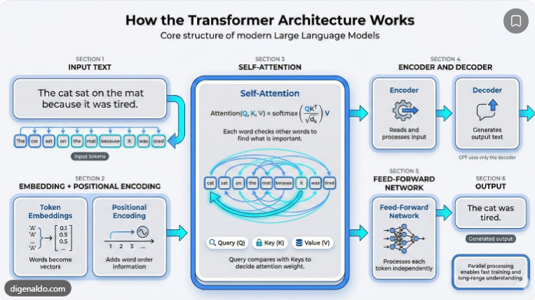
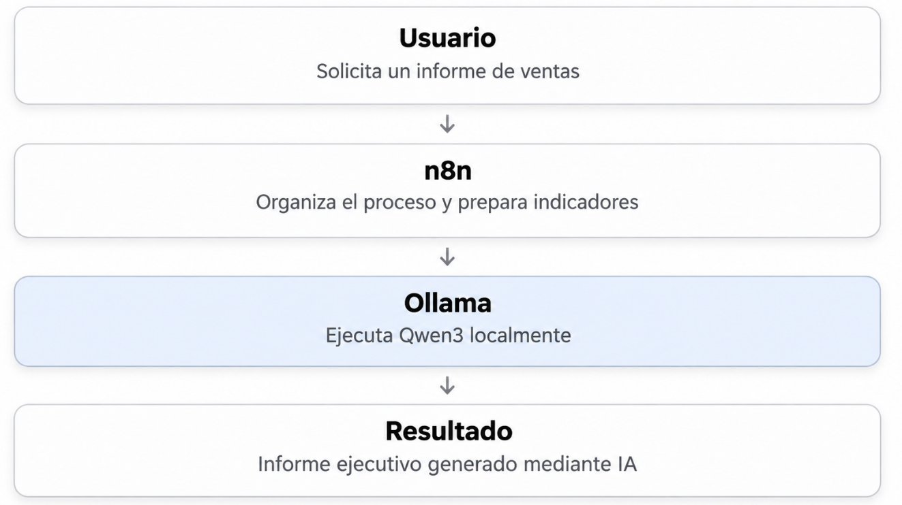

# Unidad 1 — Inteligencia Artificial Generativa aplicada a Business Intelligence

Diplomado en Business Intelligence e Inteligencia Artificial · Miércoles 11 de noviembre de 2026

Hoy comenzamos con los fundamentos de la inteligencia artificial generativa, los modelos de lenguaje (LLMs), su arquitectura y las herramientas que permiten utilizarlos.

La clase debe conectar con lo que los estudiantes ya conocen: SQL, bases de datos, R, Python, Machine Learning y Power BI.

Objetivo de aprendizaje: comprender qué es un LLM, cómo genera respuestas, por qué distintos modelos pueden responder de forma diferente y cómo utilizar esta tecnología de manera responsable en procesos de Business Intelligence.

## 1. Introducción: de Business Intelligence a inteligencia artificial generativa

### 1.1. ¿Qué es la inteligencia artificial?

La inteligencia artificial (IA) es un campo de la informática que desarrolla sistemas capaces de realizar tareas que requieren capacidades como reconocimiento de patrones, predicción, procesamiento del lenguaje, planificación o toma de decisiones.

No todos los sistemas de inteligencia artificial funcionan de la misma manera.

Algunos siguen reglas explícitas; otros aprenden patrones a partir de datos y pueden utilizarlos para realizar predicciones o generar contenido.

### 1.2. ¿Qué es Machine Learning?

El Machine Learning (aprendizaje automático) es una rama de la IA que permite construir modelos que aprenden relaciones estadísticas a partir de los datos.

En el módulo anterior, los estudiantes trabajaron con algoritmos de regresión, clasificación y agrupamiento.

Por ejemplo:

- Regresión: estimar las ventas del próximo mes.

- Clasificación: estimar la probabilidad de incumplimiento de un cliente.

- Clustering: identificar segmentos de clientes con comportamientos similares.

Estos modelos suelen diseñarse para tareas analíticas específicas.

### 1.3. ¿Qué es la IA generativa?

La inteligencia artificial generativa (Generative AI) comprende modelos que pueden producir contenido nuevo a partir de patrones aprendidos durante su entrenamiento y de las instrucciones recibidas.

Ese contenido puede ser texto, código de programación, imágenes, audio o información estructurada.

En Business Intelligence podemos utilizarla para explicar indicadores, redactar informes ejecutivos, proponer consultas SQL, documentar procesos y asistir en el desarrollo de modelos analíticos.

### Diferencia entre BI, ML e IA generativa

+-----------------------+-------------------------------------------------------+-------------------------------------+
| Tecnología            | Pregunta principal                                    | Ejemplo                             |
+=======================+=======================================================+=====================================+
| Business Intelligence | ¿Qué ocurrió?                                         | Las ventas aumentaron un 4,49 %     |
+-----------------------+-------------------------------------------------------+-------------------------------------+
| Machine Learning      | ¿Qué podría ocurrir?                                  | Predicción de ventas de abril       |
+-----------------------+-------------------------------------------------------+-------------------------------------+
| IA generativa         | ¿Cómo podemos interpretar o comunicar la información? | Elaboración de un informe ejecutivo |
+-----------------------+-------------------------------------------------------+-------------------------------------+

Esta clasificación es didáctica: las herramientas pueden combinarse y el BI también puede incorporar modelos predictivos.

### Relación entre estas tecnologías



Pregunta para los estudiantes: si ya tenemos SQL para calcular indicadores y Power BI para visualizarlos, ¿qué aporta realmente la inteligencia artificial generativa?

La respuesta es que puede facilitar la interacción con los sistemas analíticos mediante lenguaje natural y asistir en la interpretación, programación y documentación. Pero no reemplaza los cálculos verificables ni la responsabilidad del analista.

## 2. Modelos de lenguaje de gran tamaño (LLMs)

### 2.1. ¿Qué es un LLM?

Un Large Language Model (LLM) es un modelo de aprendizaje automático entrenado con grandes cantidades de información para procesar y generar lenguaje.

Los modelos de lenguaje actuales pueden realizar diferentes actividades, como responder preguntas, resumir documentos, traducir textos, generar código y producir explicaciones.

Entre las familias de modelos que podemos estudiar se encuentran GPT, Claude, Gemini, DeepSeek y Qwen.

Una distinción importante: ChatGPT es una aplicación que permite interactuar con modelos; GPT es una familia de modelos. No debemos confundir la interfaz con el modelo que la utiliza.

### 2.2. ¿Cómo aprende un LLM?

Durante el entrenamiento, el modelo ajusta sus parámetros matemáticos para identificar patrones presentes en los datos.

Una tarea fundamental en muchos modelos de lenguaje es aprender a predecir el siguiente token a partir de los anteriores.

Imaginemos la siguiente frase:

> Las ventas de la empresa aumentaron durante el mes de...

Un modelo de lenguaje puede asignar diferentes probabilidades a las continuaciones posibles de la secuencia.

A partir de estas predicciones repetidas, puede producir párrafos completos.

Sin embargo, la generación de un texto convincente no garantiza que su contenido corresponda con información empresarial verdadera.

### 2.3. ¿Qué son los tokens?

Los LLMs no procesan necesariamente el texto palabra por palabra. Utilizan unidades denominadas tokens.

Un token puede representar una palabra completa, una parte de una palabra, un símbolo o una secuencia de caracteres.

Ejemplo conceptual de tokenización

«Analicemos las ventas mensuales»

Analicemos

las

ventas

mensuales

Separación ilustrativa. La tokenización real depende del tokenizador y podría dividir estas palabras de otra manera.

Los tokens son importantes porque influyen en la capacidad de contexto, el procesamiento de información y, en determinadas APIs comerciales, el costo del servicio.

### 2.4. ¿Qué es un prompt?

Un prompt es una instrucción o conjunto de mensajes que proporcionamos a un modelo para orientar su respuesta.

Por ejemplo, podemos escribir:

> Explícame las ventas.

Pero también podemos proporcionar una instrucción más específica:

> Actúa como analista de Business Intelligence. Utiliza los datos de ventas de enero, febrero y marzo para identificar variaciones mensuales. Presenta los cálculos y redacta una conclusión de máximo 100 palabras. No inventes explicaciones.

La segunda instrucción define mejor la tarea, el contexto, el formato y las restricciones.

Este concepto será desarrollado con mayor profundidad en la Unidad 2, dedicada a Prompt Engineering.

### 2.5. ¿Qué es la ventana de contexto?

Es la cantidad de información, medida habitualmente en tokens, que un modelo puede procesar dentro de una interacción, según sus límites y configuración.

El contexto puede contener instrucciones, mensajes anteriores, documentos, datos empresariales y resultados de herramientas.

Por ejemplo, si proporcionamos un diccionario de datos, el modelo puede utilizar esas definiciones para interpretar las variables de una base.

No obstante, una ventana de contexto más grande no garantiza automáticamente respuestas más precisas.

## 3. Primera actividad: ¿todos los LLMs responden igual?

Duración sugerida: 30 minutos

Ahora podemos realizar la actividad comparativa que conversamos anteriormente.

Abriremos cuatro aplicaciones de IA generativa: [ChatGPT](https://chatgpt.com/?utm_source=chatgpt.com), [DeepSeek](https://chat.deepseek.com/?utm_source=chatgpt.com), [Claude](https://claude.ai/?utm_source=chatgpt.com) y [Gemini](https://gemini.google.com/?utm_source=chatgpt.com).

Cada estudiante utilizará el mismo prompt, con los mismos datos.

### Datos del ejercicio

| Mes     | Ventas USD |
|---------|------------|
| Enero   | 167.000    |
| Febrero | 174.500    |
| Marzo   | 174.600    |

### Instrucción que proporcionaremos

Prompt para la práctica

Actúa como analista de Business Intelligence. Una empresa registra ventas de USD 167.000 en enero, USD 174.500 en febrero y USD 174.600 en marzo. Calcula las variaciones porcentuales mensuales, interpreta la evolución y redacta una conclusión ejecutiva de máximo 100 palabras. Explica los cálculos y no inventes causas de las variaciones.

Copiar prompt

Los estudiantes compararán las respuestas considerando exactitud numérica, interpretación, claridad y afirmaciones no sustentadas.

### Resultados correctos para verificar

$$
g_{febrero}=\frac{174500-167000}{167000}\times100=4,49\%
$$

$$
g_{marzo}=\frac{174600-174500}{174500}\times100\approx0,06\%
$$

La conclusión respaldada por los datos es que las ventas aumentaron en ambos períodos, pero el crecimiento mensual se desaceleró considerablemente.

No podemos concluir, únicamente con estas cifras, que hubo mejores estrategias comerciales, variaciones en los precios, cambios de rentabilidad o una tendencia de largo plazo.

### ¿Qué debe aprender el estudiante?

Distintos asistentes pueden generar respuestas diferentes porque pueden utilizar modelos, configuraciones e instrucciones de sistema distintas.

Incluso un mismo modelo puede producir respuestas variables según la configuración de generación.

Por tanto, no podemos afirmar que un LLM es mejor que otro por una única respuesta.

## 4. Arquitectura de un LLM: ¿qué ocurre dentro del modelo?

### 4.1. La arquitectura Transformer

La arquitectura Transformer fue presentada por Vaswani y colaboradores en 2017, en el trabajo Attention Is All You Need.

Este enfoque utiliza mecanismos de atención para procesar relaciones entre elementos de una secuencia.

Muchos LLMs modernos se construyen sobre variantes de esta arquitectura.



### 4.2. ¿Qué es el mecanismo de atención?

El mecanismo de atención permite que un modelo combine información de distintas posiciones del contexto para construir sus representaciones.

Consideremos la frase:

> La empresa presentó un incremento de ventas porque sus productos tuvieron mayor demanda.

Para procesar la oración, el modelo necesita considerar las relaciones entre «empresa», «incremento», «ventas», «productos» y «demanda».

En términos técnicos, la atención utiliza representaciones denominadas queries, keys y values para calcular cómo se combina la información.

No es necesario desarrollar toda la formulación matemática en esta clase, pero sí comprender que la atención es un mecanismo computacional, no una garantía de comprensión factual.

### 4.3. Etapas simplificadas del procesamiento

1.  El usuario introduce una instrucción.

2.  El texto se divide en tokens.

3.  Los tokens se transforman en representaciones numéricas.

4.  Las capas del Transformer procesan las relaciones contextuales.

5.  El modelo calcula probabilidades de tokens de salida.

6.  Se seleccionan tokens sucesivamente hasta producir la respuesta.

### 4.4. Entrenamiento frente a inferencia

Es importante diferenciar:

+----------------------------------+---------------------------------------------------------------------------------+
| Proceso                          | Qué sucede                                                                      |
+==================================+=================================================================================+
| Preentrenamiento                 | Se optimizan los parámetros del modelo con grandes conjuntos de datos           |
+----------------------------------+---------------------------------------------------------------------------------+
| Fine-tuning                      | Se adapta un modelo previamente entrenado                                       |
+----------------------------------+---------------------------------------------------------------------------------+
| Inferencia                       | El modelo genera una respuesta usando los parámetros existentes                 |
+----------------------------------+---------------------------------------------------------------------------------+
| RAG                              | Se recupera información externa para enriquecer el contexto                     |
+----------------------------------+---------------------------------------------------------------------------------+
| Tool calling                     | El modelo solicita utilizar una herramienta, que ejecuta una aplicación externa |
+----------------------------------+---------------------------------------------------------------------------------+

Cuando utilizamos Qwen3 mediante Ollama, no lo entrenamos desde cero. Simplemente ejecutamos un modelo previamente entrenado.

## 5. Ecosistema de IA generativa: modelos, aplicaciones y agentes

Una de las confusiones frecuentes es pensar que todas las herramientas de IA hacen exactamente lo mismo.

### 5.1. Modelos

Son los sistemas que procesan entradas y producen resultados.

Ejemplos: GPT, Claude, Gemini, DeepSeek y Qwen.

### 5.2. Aplicaciones

Ofrecen una interfaz para interactuar con los modelos.

Por ejemplo, ChatGPT permite conversar con modelos de OpenAI.

### 5.3. Ejecutores de modelos

Permiten ejecutar determinados modelos, incluso localmente.

Ollama es un ejemplo de esta categoría.

### 5.4. Agentes de IA

Un agente puede utilizar modelos e instrumentos externos para realizar tareas con cierto grado de autonomía operativa y bajo restricciones definidas.

Por ejemplo, OpenCode es una herramienta orientada al trabajo con código, archivos y comandos.

Un agente empresarial de BI podría disponer de herramientas para consultar vistas autorizadas de una base de datos.

### 5.5. Automatizadores

Conectan diferentes aplicaciones y procesos.

n8n permite diseñar flujos en los que se ejecutan tareas de manera secuencial o condicionada.

No necesitamos confundir automatización y agentes: un flujo puede incorporar IA sin que el modelo decida qué herramienta utilizar.

### ¿Cómo se conectan estas tecnologías?

Usuario

Solicita un informe de ventas

n8n

Organiza el proceso y prepara indicadores

Ollama

Ejecuta Qwen3 localmente

Resultado

Informe ejecutivo generado mediante IA

Esta es precisamente la arquitectura básica que conseguimos ejecutar en nuestro computador.

## 6. Limitaciones de los LLMs

### 6.1. Alucinaciones

Los modelos pueden generar afirmaciones incorrectas o no sustentadas.

En nuestra demostración con Ollama, cuando enviamos instrucciones sin incluir correctamente las cifras de ventas, el modelo generó indicadores inexistentes.

Esto demuestra que necesitamos verificar las respuestas antes de utilizar la información.

### 6.2. Errores numéricos

Los LLMs no deben utilizarse como sustitutos automáticos de herramientas de cálculo.

En BI, las agregaciones, porcentajes y validaciones deben obtenerse preferentemente mediante operaciones verificables en SQL, Python, R o DAX.

### 6.3. Conocimiento incompleto

Un LLM no conoce automáticamente la estructura de nuestra base de datos ni las definiciones institucionales de indicadores.

Si le preguntamos por una columna que no hemos documentado, puede generar una interpretación incorrecta.

### 6.4. Privacidad y confidencialidad

No debemos introducir información sensible de clientes, instituciones o empresas en plataformas externas sin autorización y sin conocer las condiciones de tratamiento de datos.

Para nuestras prácticas utilizaremos datos simulados.

### 6.5. Dependencia del contexto

Una instrucción ambigua o con información insuficiente puede producir respuestas genéricas o no verificables.

Por eso es importante proporcionar contexto y validar el resultado.

## 7. Aplicación conceptual a Business Intelligence

El proceso tradicional de BI puede representarse así:

`Base de datos → SQL → Transformación → Power BI → Informe`

Con IA generativa podemos incorporar asistencia en diferentes etapas:

| Etapa del BI   | Aplicación de IA                               |
|----------------|------------------------------------------------|
| Extracción     | Proponer consultas SQL                         |
| Transformación | Ayudar a desarrollar código Python o R         |
| Modelado       | Documentar variables y relaciones              |
| Visualización  | Explicar medidas DAX y sugerir gráficos        |
| Análisis       | Interpretar indicadores calculados             |
| Comunicación   | Redactar informes ejecutivos                   |
| Automatización | Coordinar el envío o publicación de resultados |

La idea central no es reemplazar SQL, Python, R ni Power BI, sino integrar la inteligencia artificial para mejorar el trabajo analítico.

## 9. Tipos de LLMs disponibles en el mercado: modelos gratuitos, aplicaciones y limitaciones

Unidad 1 · Sección adicional de teoría · Actualizado al 11 de noviembre de 2026

Esta sección se incorpora después del apartado «Ecosistema de IA generativa: modelos, aplicaciones y agentes», antes de estudiar sus aplicaciones en Business Intelligence.

### 9.1. ¿Todos los LLMs son iguales?

No. Los modelos de lenguaje se diferencian por su arquitectura, capacidad, entrenamiento, modalidad de entrada y salida, condiciones de acceso y recursos necesarios para ejecutarlos.

Podemos clasificarlos de la siguiente manera:

+------------------------------+---------------------------------------------------------------+-----------------------------------------------------+
| Tipo de modelo               | Característica                                                | Ejemplo de aplicación en BI                         |
+==============================+===============================================================+=====================================================+
| Propósito general            | Comprende instrucciones y genera texto                        | Elaborar informes ejecutivos                        |
+------------------------------+---------------------------------------------------------------+-----------------------------------------------------+
| Especializado en código      | Orientado a generar, revisar y explicar programación          | Crear consultas SQL o revisar scripts Python        |
+------------------------------+---------------------------------------------------------------+-----------------------------------------------------+
| Orientado al razonamiento    | Optimizado para resolver problemas que requieren varios pasos | Analizar inconsistencias en reglas de negocio       |
+------------------------------+---------------------------------------------------------------+-----------------------------------------------------+
| Multimodal                   | Procesa más de una modalidad, como texto e imágenes           | Interpretar capturas de dashboards                  |
+------------------------------+---------------------------------------------------------------+-----------------------------------------------------+
| Modelo pequeño (SLM)         | Menor tamaño y requerimientos de infraestructura              | Clasificar comentarios o redactar resúmenes locales |
+------------------------------+---------------------------------------------------------------+-----------------------------------------------------+
| Modelo con pesos disponibles | Permite descargar y ejecutar sus parámetros bajo una licencia | Ejecutar un asistente local con Ollama              |
+------------------------------+---------------------------------------------------------------+-----------------------------------------------------+
| Modelo propietario           | Su acceso y despliegue dependen del proveedor                 | Utilizar modelos mediante una plataforma comercial  |
+------------------------------+---------------------------------------------------------------+-----------------------------------------------------+

Estas categorías no son excluyentes. Un modelo puede ser pequeño, multimodal y especializado en código al mismo tiempo.

Además, pesos disponibles no significa necesariamente código abierto ni uso comercial irrestricto. Debemos revisar la licencia de cada modelo.

### 9.2. Principales asistentes gratuitos del mercado

Para esta comparación debemos distinguir el modelo (GPT, Claude, Gemini, DeepSeek) de la aplicación (ChatGPT, Claude.ai, Gemini, DeepSeek Chat).

La siguiente tabla compara aplicaciones accesibles desde el navegador. Las modalidades gratuitas pueden tener restricciones de uso diferentes según el proveedor.

+--------------+--------------------------------------------------------------------------------------------------+------------------------------------------------------------------------------------------------------------------------------+
| Plataforma   | ¿Para qué sirve en BI?                                                                           | Acceso gratuito y limitaciones                                                                                               |
+==============+==================================================================================================+==============================================================================================================================+
| ChatGPT      | Explicar SQL, apoyar análisis de archivos, revisar Python, redactar informes                     | Plan gratuito con límites independientes para modelos, archivos, imágenes y análisis de datos.                               |
|              |                                                                                                  |                                                                                                                              |
|              |                                                                                                  | OpenAI Help Center                                                                                                           |
+--------------+--------------------------------------------------------------------------------------------------+------------------------------------------------------------------------------------------------------------------------------+
| Gemini       | Analizar documentos, explicar código, sintetizar información y trabajar con contenido multimodal | Acceso sin suscripción de pago, con límites que dependen del modelo, función y complejidad de la solicitud.                  |
|              |                                                                                                  |                                                                                                                              |
|              |                                                                                                  | Ayuda de Aplicaciones de Gemini                                                                                              |
+--------------+--------------------------------------------------------------------------------------------------+------------------------------------------------------------------------------------------------------------------------------+
| Claude       | Redacción técnica, revisión de código, documentación y análisis de textos                        | Plan gratuito para uso ocasional; el límite de sesión se restablece cada cinco horas y la capacidad disponible puede variar. |
|              |                                                                                                  |                                                                                                                              |
|              |                                                                                                  | Centro de ayuda de Anthropic+1                                                                                               |
+--------------+--------------------------------------------------------------------------------------------------+------------------------------------------------------------------------------------------------------------------------------+
| DeepSeek     | Generar código, explicar procedimientos analíticos y resolver problemas técnicos                 | DeepSeek ofrece una aplicación gratuita. No puedo confirmar una cuota fija vigente de mensajes para todos los usuarios.      |
|              |                                                                                                  |                                                                                                                              |
|              |                                                                                                  | Introducing DeepSeek App                                                                                                     |
+--------------+--------------------------------------------------------------------------------------------------+------------------------------------------------------------------------------------------------------------------------------+
| Perplexity   | Investigar metodologías, localizar documentación SQL y recopilar referencias verificables        | Plan gratuito centrado en búsqueda; las búsquedas avanzadas y cargas de archivos son limitadas.                              |
|              |                                                                                                  |                                                                                                                              |
|              |                                                                                                  | Perplexity Help Center                                                                                                       |
+--------------+--------------------------------------------------------------------------------------------------+------------------------------------------------------------------------------------------------------------------------------+
| Mistral Vibe | Redactar, investigar, generar código y experimentar con asistentes                               | Plan gratuito con mensajes, búsquedas y sesiones de programación limitados.                                                  |
|              |                                                                                                  |                                                                                                                              |
|              |                                                                                                  | AI chat and coding agent+1                                                                                                   |
+--------------+--------------------------------------------------------------------------------------------------+------------------------------------------------------------------------------------------------------------------------------+

Nota: los usos indicados son aplicaciones posibles para la enseñanza de BI, no una clasificación de desempeño ni una garantía de exactitud. La disponibilidad de herramientas puede variar entre cuentas y países.

### 9.3. ¿Qué plataforma elegir según la tarea?


ChatGPT — Análisis de datos y programación

Puede utilizarse para explicar código SQL, Python y R; interpretar resultados, preparar documentación y explorar archivos de datos.

Limitación: los resultados numéricos y el código propuesto requieren validación. El acceso a herramientas avanzadas está sujeto a límites.


Gemini — Documentos, contenido multimodal y código

Podemos utilizarlo para revisar documentos empresariales, comparar explicaciones de indicadores y analizar imágenes o tablas, cuando la función esté disponible.

Limitación: las cuotas y el acceso a determinados modelos y funciones cambian según el plan.


Claude — Redacción y revisión técnica

Es una alternativa para comparar informes ejecutivos, evaluar instrucciones y revisar scripts de programación.

Limitación: su capacidad gratuita de uso es restringida y las conversaciones extensas pueden consumirla más rápidamente.


DeepSeek — Razonamiento y programación

Podemos emplearlo para solicitar explicaciones matemáticas, construir consultas SQL y comparar soluciones de Python.

Limitación: la gratuidad de la aplicación web no equivale a acceso ilimitado o gratuito a su API.


Perplexity — Investigación con referencias

Resulta útil para localizar documentación técnica, artículos académicos y fuentes institucionales que después revisaremos directamente.

Limitación: las citas también deben verificarse y el plan gratuito restringe el acceso avanzado.

Importante para los estudiantes: estas son alternativas para diferentes necesidades, no un ranking. El desempeño debe comprobarse con pruebas representativas de la tarea que necesitamos resolver.

### 9.4. LLMs gratuitos que podemos ejecutar localmente

Hasta ahora hablamos de aplicaciones web. Existe otra modalidad: descargar un modelo y ejecutarlo en nuestro propio computador.

Para ello podemos utilizar Ollama.

La biblioteca de Ollama incluye distintas familias de modelos descargables, con tamaños y capacidades diferentes.

ollama.com

+----------------------+-----------------------------------------------------------------------------------------+----------------------------------------------------+
| Familia de modelos   | Características                                                                         | Aplicación posible en BI                           |
+======================+=========================================================================================+====================================================+
| Qwen                 | Modelos de distintos tamaños, con capacidades multilingües, razonamiento y herramientas | Informes, SQL y asistentes locales                 |
+----------------------+-----------------------------------------------------------------------------------------+----------------------------------------------------+
| Llama                | Familia de modelos de Meta, con versiones pequeñas y grandes                            | Resúmenes, clasificación y análisis textual        |
+----------------------+-----------------------------------------------------------------------------------------+----------------------------------------------------+
| Gemma                | Modelos de Google, con versiones compactas y multimodales                               | Asistencia documental e interpretación de imágenes |
+----------------------+-----------------------------------------------------------------------------------------+----------------------------------------------------+
| DeepSeek-R1          | Familia orientada al razonamiento                                                       | Problemas analíticos de varios pasos               |
+----------------------+-----------------------------------------------------------------------------------------+----------------------------------------------------+
| Mistral              | Familia con alternativas relativamente compactas                                        | Procesamiento y generación de texto                |
+----------------------+-----------------------------------------------------------------------------------------+----------------------------------------------------+
| Qwen Coder           | Modelos especializados en programación                                                  | Generar, explicar y corregir código                |
+----------------------+-----------------------------------------------------------------------------------------+----------------------------------------------------+

Estas posibilidades están documentadas en el catálogo de Ollama.

ollama.com+3

#### ¿Qué significan 1.7B, 4B, 8B o 14B?

La letra B significa billion, es decir, mil millones de parámetros.

Los parámetros son valores numéricos aprendidos durante el entrenamiento que intervienen en el procesamiento del modelo.

Por ejemplo:

Qwen3 1.7B

1,7 mil millones

Qwen3 4B

4 mil millones

Qwen3 8B

8 mil millones

Qwen3 14B

14 mil millones

Comparación del número de parámetros, no de calidad o rendimiento.

En general, un modelo con más parámetros puede requerir más memoria y capacidad de procesamiento. No obstante, más parámetros no garantizan mejor desempeño en todas las tareas.

Por ejemplo, Ollama publica los siguientes tamaños aproximados de descarga para determinadas variantes de Qwen3:

| Modelo     | Tamaño publicado |
|------------|------------------|
| Qwen3 1.7B | 1,4 GB           |
| Qwen3 4B   | 2,5 GB           |
| Qwen3 8B   | 5,2 GB           |
| Qwen3 14B  | 9,3 GB           |

qwen3

Estos tamaños corresponden a los archivos distribuidos; no representan toda la memoria RAM necesaria durante la ejecución.

En nuestra práctica utilizamos `qwen3:1.7b`, un modelo relativamente pequeño. Es adecuado para demostrar cómo funciona una solicitud local, pero no debemos asumir que resolverá correctamente problemas complejos de SQL o razonamiento.

### 9.5. ¿Cuáles son las limitaciones de los LLMs gratuitos?

Podemos identificar seis limitaciones importantes:

1\. Límites de uso. Algunas aplicaciones restringen mensajes, herramientas, cargas de archivos o capacidad de procesamiento.

2\. Restricciones de modelos. Los planes gratuitos pueden ofrecer menos opciones o menor acceso a determinados modelos.

3\. Infraestructura. Los modelos locales utilizan memoria RAM, procesamiento, almacenamiento y energía.

4\. Privacidad. Los servicios en la nube requieren revisar las políticas de tratamiento de datos. Los modelos locales también necesitan controles de acceso.

5\. Exactitud. Ningún LLM garantiza resultados correctos en todas las tareas. Es fundamental verificar SQL, operaciones matemáticas e interpretaciones.

6\. Integraciones. El acceso gratuito a una página de chat no significa que podamos conectarla gratuitamente con n8n o con aplicaciones mediante API.

### 9.6. ¿Cuál utilizaríamos para cada necesidad del diplomado?

Esta es una matriz de selección didáctica, no una clasificación experimental de rendimiento:

+----------------------------------+---------------------------------------------+------------------------------------+
| Necesidad                        | Alternativa para probar                     | Verificación necesaria             |
+==================================+=============================================+====================================+
| Comprender conceptos de IA       | ChatGPT, Gemini, Claude o DeepSeek          | Contrastar definiciones            |
+----------------------------------+---------------------------------------------+------------------------------------+
| Generar SQL                      | ChatGPT, DeepSeek o Claude                  | Ejecutar en DBeaver                |
+----------------------------------+---------------------------------------------+------------------------------------+
| Revisar Python o R               | Cualquier asistente con capacidad de código | Ejecutar pruebas                   |
+----------------------------------+---------------------------------------------+------------------------------------+
| Investigar documentación técnica | Perplexity y fuentes oficiales              | Abrir las referencias originales   |
+----------------------------------+---------------------------------------------+------------------------------------+
| Redactar informes ejecutivos     | ChatGPT, Gemini, Claude o un modelo local   | Validar indicadores y conclusiones |
+----------------------------------+---------------------------------------------+------------------------------------+
| Ejecutar IA local                | Ollama + Qwen, Llama o Gemma                | Comprobar recursos y calidad       |
+----------------------------------+---------------------------------------------+------------------------------------+
| Automatizar informes             | n8n + un modelo compatible                  | Validar el flujo completo          |
+----------------------------------+---------------------------------------------+------------------------------------+

# **Unidad 2. Prompt Engineering aplicado a Business Intelligence**

# **2.1. Tipos de prompts**

## **2.1.1. ¿Qué es Prompt Engineering?**

El **Prompt Engineering**, o ingeniería de instrucciones, es el proceso sistemático de diseñar, probar y mejorar las instrucciones que reciben los modelos de inteligencia artificial para obtener respuestas que satisfagan determinados objetivos.

No consiste simplemente en escribir preguntas más largas.

Implica especificar correctamente:

- Qué tarea debe realizar el modelo.

- Qué información tiene disponible.

- Qué reglas debe respetar.

- Cómo debe presentar sus resultados.

- Cómo comprobaremos que respondió correctamente.

La documentación técnica de OpenAI y Anthropic destaca la importancia de instrucciones claras, ejemplos relevantes y evaluaciones para conseguir resultados consistentes.

OpenAI API+1

### **¿Por qué es importante en Business Intelligence?**

Imaginemos que una empresa necesita un informe sobre sus ventas.

El analista puede proporcionar la siguiente instrucción:

> Analiza las ventas de la empresa.

Pero esta instrucción es ambigua. No especifica las variables, el período, las métricas ni el resultado esperado.

En cambio, podríamos solicitar:

> Actúa como analista de Business Intelligence. Utiliza las ventas mensuales suministradas, calcula las variaciones porcentuales, identifica los principales hallazgos y redacta una conclusión ejecutiva. No inventes explicaciones causales.

La segunda instrucción establece un objetivo más claro y proporciona restricciones relevantes.

En ambos casos estamos utilizando el mismo modelo, pero modificamos la información y las instrucciones disponibles.

## **2.1.2. Zero-shot prompting**

El *zero-shot prompting* consiste en solicitar una tarea al modelo **sin proporcionar ejemplos resueltos de cómo debe realizarla**.

El modelo utiliza sus capacidades previamente aprendidas y la información incluida en la solicitud.

Zero-shot

**Sin ejemplos**

Prompt

Clasifica el siguiente comentario de un cliente como positivo, negativo o neutral:

«La transferencia se procesó correctamente, pero tardó más de lo esperado».

**Respuesta posible:** Negativo, si el modelo prioriza la demora reportada.

La clasificación no es necesariamente única: el comentario también contiene una valoración positiva. Una definición empresarial de las categorías ayudaría a reducir esa ambigüedad.

**Aplicaciones en BI:** clasificación exploratoria de comentarios, explicación de indicadores, generación inicial de consultas SQL o resúmenes de información.

## **2.1.3. One-shot prompting**

En *one-shot prompting* proporcionamos **un ejemplo de entrada y su respuesta esperada** antes de presentar la nueva tarea.

El ejemplo demuestra el patrón que queremos reproducir.

One-shot

**Un ejemplo**

EJEMPLO

Comentario: «La aplicación presenta errores al iniciar sesión».

Clasificación: Negativo.

NUEVA ENTRADA

Comentario: «El asesor resolvió rápidamente mi solicitud».

Clasificación:

**Respuesta esperada:** Positivo.

En este caso, el modelo recibe un ejemplo del formato y la tarea.

La utilidad principal es orientar el comportamiento sin modificar los parámetros del modelo.

## **2.1.4. Few-shot prompting**

El *few-shot prompting* consiste en proporcionar **varios ejemplos representativos** de la tarea que queremos resolver.

Es particularmente útil cuando necesitamos establecer criterios de clasificación o formatos de respuesta.

Ejemplo:

```         
Clasifica cada reclamo según su categoría.  Ejemplo 1: Texto: "El cajero no entregó mi dinero". Categoría: Cajero automático  Ejemplo 2: Texto: "No reconozco una compra con mi tarjeta". Categoría: Tarjeta de crédito  Ejemplo 3: Texto: "La transferencia no llegó al destinatario". Categoría: Transferencias  Ahora clasifica: Texto: "Me cobraron dos veces por una compra con mi tarjeta". Categoría:
```

La respuesta dependerá del catálogo institucional de categorías y de la interpretación de la operación. Si es necesario distinguir tarjeta de débito y tarjeta de crédito, el prompt deberá incluir esa regla.

### **Comparación de las tres técnicas**

| Técnica | Ejemplos proporcionados | Uso recomendado |
|----|----|----|
| Zero-shot | 0 | Tareas sencillas o exploratorias |
| One-shot | 1 | Mostrar un formato o patrón |
| Few-shot | Varios | Clasificaciones y formatos que requieren consistencia |

### **Comparación conceptual**

**Zero-shot**

Instrucción → Modelo → Respuesta

**One-shot**

1 ejemplo + instrucción → Modelo → Respuesta

**Few-shot**

Varios ejemplos + instrucción → Modelo → Respuesta

Estos métodos están asociados al aprendizaje a partir del contexto (*in-context learning*). No implican volver a entrenar el LLM.

OpenAI API

## **2.1.5. Role prompting**

El *role prompting* consiste en asignar al modelo un papel o función dentro de la tarea.

Por ejemplo:

> Actúa como econometrista especializado en análisis de series temporales.

O:

> Actúa como analista de riesgos financieros de una entidad bancaria.

El rol ayuda a definir el enfoque, la terminología y el tipo de respuesta esperado.

Sin embargo, **asignar un rol profesional no garantiza que el modelo posea conocimientos correctos ni sustituye la validación técnica**.

### **Ejemplo aplicado a Power BI**

Prompt básico:

> Explícame este código DAX.

Prompt con rol:

> Actúa como especialista en modelado semántico de Power BI. Explica la medida DAX suministrada, identifica el contexto de filtros y señala posibles problemas de rendimiento. No supongas relaciones entre tablas que no se hayan documentado.

El segundo ejemplo proporciona un enfoque y controles más específicos.

## **2.1.6. Prompts de salida estructurada**

En determinadas aplicaciones necesitamos que el modelo devuelva información siguiendo un formato previamente definido.

Por ejemplo, JSON:

```         
{   "indicador": "crecimiento_ventas",   "periodo": "febrero_2026",   "valor_pct": 4.49,   "interpretacion": "Las ventas aumentaron respecto a enero." }
```

Esta estructura facilita que otros programas procesen la respuesta.

En Business Intelligence, una salida estructurada puede utilizarse para construir reportes, alimentar aplicaciones o registrar resultados.

No obstante, **solicitar JSON en el prompt no garantiza por sí solo que la salida sea válida**. Las aplicaciones deben validar su estructura y, cuando el servicio lo permita, utilizar mecanismos específicos de salida estructurada.

OpenAI API

# **2.2. Diseño de prompts**

Una vez que conocemos los tipos de prompts, debemos aprender a construir instrucciones que puedan reutilizarse en problemas empresariales.

## **2.2.1. Componentes de un prompt estructurado**

Propongo enseñar seis componentes fundamentales.

**1**

**Rol**

¿Desde qué perspectiva responderá?

**2**

**Objetivo**

¿Qué tarea concreta realizará?

**3**

**Contexto y datos**

¿Con qué información trabajará?

**4**

**Restricciones**

¿Qué no puede hacer o asumir?

**5**

**Formato de salida**

¿Cómo debe entregar los resultados?

**6**

**Criterios de verificación**

¿Cómo determinaremos si respondió correctamente?

Esta es una plantilla pedagógica que podemos adaptar según la complejidad del problema.

No todos los prompts requieren los seis elementos, pero resulta útil para enseñar a los estudiantes a no omitir información crítica.

## **2.2.2. Ejemplo completo: análisis de ventas**

Utilizaremos los datos de la empresa ficticia que trabajamos en la Unidad 1.

| Mes     | Ventas USD |
|---------|------------|
| Enero   | 167.000    |
| Febrero | 174.500    |
| Marzo   | 174.600    |

EJEMPLO DE PROMPT ESTRUCTURADO

```         
 ROL: Actúa como analista de Business Intelligence.  OBJETIVO: Analiza la evolución mensual de las ventas de una empresa comercial.  DATOS: Enero: USD 167000 Febrero: USD 174500 Marzo: USD 174600  INSTRUCCIONES: - Calcula las variaciones porcentuales mensuales. - Identifica los principales hallazgos. - Distingue hechos de hipótesis.  RESTRICCIONES: - No inventes causas del crecimiento. - No agregues cifras no proporcionadas. - No realices pronósticos. - Indica las limitaciones de los datos.  FORMATO: 1. Tabla de indicadores. 2. Interpretación. 3. Conclusión ejecutiva de máximo 100 palabras.  VERIFICACIÓN: Incluye la fórmula utilizada y las cifras que permiten reproducir cada cálculo.   
```

### **¿Por qué es mejor que una instrucción genérica?**

Porque reduce la ambigüedad en aspectos concretos: identifica los datos, especifica la tarea, delimita las inferencias permitidas y establece un formato evaluable.

Eso no elimina la posibilidad de errores; facilita su detección.

## **2.2.3. Delimitadores y separación entre instrucciones y datos**

En determinadas tareas, el modelo recibe documentos extensos o información procedente de varias fuentes.

Podemos utilizar encabezados y delimitadores para separar las instrucciones de los datos.

Por ejemplo:

```         
INSTRUCCIÓN: Resume únicamente los registros suministrados.  DATOS: """ Ciudad: Quito Ventas: 85000  Ciudad: Cuenca Ventas: 62000 """  FORMATO: Tabla ordenada de mayor a menor venta.
```

Esta separación ayuda a identificar qué parte es una instrucción y qué parte constituye información para analizar.

OpenAI API+1

También aporta claridad cuando incorporamos documentos empresariales.

## **2.2.4. Prompt Engineering y diccionario de datos**

En Business Intelligence, un prompt no debe utilizar variables cuya interpretación no haya sido definida.

Por ejemplo, si una base contiene las variables:

`saldo_total`, `saldo_vencido`, `fecha_corte`

El modelo necesita conocer qué representa cada una.

Sin esa información, podría interpretar incorrectamente la morosidad, la cartera improductiva o la periodicidad de los registros.

La calidad del prompt depende también de la calidad del contexto empresarial.

# **2.3. Optimización de prompts**

## **2.3.1. ¿Qué significa optimizar un prompt?**

La optimización consiste en modificar sistemáticamente una instrucción para mejorar su desempeño frente a criterios definidos.

No debemos asumir que agregar más palabras produce necesariamente mejores respuestas.

Un prompt puede ser extenso y seguir siendo ambiguo, contradictorio o insuficiente.

### **Ciclo de optimización**

**1. Diseñar prompt inicial**

**2. Ejecutar sobre casos de prueba**

**3. Evaluar resultados**

**4. Identificar errores**

**5. Modificar y volver a evaluar**

Esto se parece a otros procesos de experimentación que los estudiantes ya conocen de Machine Learning: formulamos una alternativa, la probamos y evaluamos su desempeño.

Sin embargo, optimizar un prompt no es equivalente a entrenar los parámetros de un modelo.

## **2.3.2. Evaluación cuantitativa de prompts**

Supongamos que tenemos 20 preguntas empresariales para las cuales conocemos la respuesta correcta.

Podemos evaluar un prompt mediante:

\\\[ Exactitud=\\frac{\\text{Respuestas correctas}}{\\text{Total de preguntas}}\\times100 \\\]

Si obtiene 17 respuestas correctas:

\\\[ Exactitud=\\frac{17}{20}\\times100=85\\% \\\]

Este indicador mide el desempeño en ese conjunto concreto de preguntas, bajo las condiciones de la prueba.

No demuestra que el prompt tenga una exactitud del 85 % para cualquier problema empresarial.

### **Matriz de evaluación propuesta**

| Criterio       | Qué evaluamos                            |
|----------------|------------------------------------------|
| Exactitud      | Cifras y afirmaciones correctas          |
| Completitud    | Cumplimiento de los requerimientos       |
| Consistencia   | Estabilidad entre ejecuciones            |
| Fundamentación | Uso de información respaldada            |
| Formato        | Cumplimiento de la estructura solicitada |
| Seguridad      | Respeto de restricciones y permisos      |

Podemos calificar cada criterio con una escala definida previamente, por ejemplo de 0 a 2 puntos, y obtener un máximo de 12 puntos.

Esta rúbrica es una propuesta docente; no es una métrica estándar universal.

## **2.3.3. Comparación controlada de prompts**

Para comparar dos instrucciones debemos controlar, en lo posible, otras variables.

Conviene mantener constantes:

- El modelo y su versión.

- Los datos proporcionados.

- La tarea evaluada.

- Las condiciones de ejecución y parámetros de generación.

- El procedimiento de evaluación.

Así podemos atribuir con mayor fundamento las diferencias observadas al cambio en el prompt.

En sistemas de producción, la documentación de OpenAI recomienda realizar evaluaciones con casos representativos y controlar las versiones del modelo y de las instrucciones.

OpenAI API

## **2.3.4. Reducción de alucinaciones**

Recordemos lo que ocurrió en nuestra práctica con Ollama.

Cuando el modelo recibió instrucciones sin incluir correctamente las cifras, generó indicadores inexistentes.

Posteriormente mejoramos el prompt e incorporamos los datos reales.

La estrategia correcta no consiste solamente en ordenar «no alucines».

Debemos proporcionar datos verificables, limitar las inferencias, distinguir información faltante y validar los resultados.

**Ejemplo de restricción:**

> Utiliza exclusivamente los indicadores suministrados. Si no dispones de información suficiente para explicar una variación, indica que no es posible determinar su causa.

Esta instrucción ayuda a delimitar la tarea, pero sigue siendo necesario verificar la salida.

## **2.3.5. ¿Qué es la temperatura?**

La temperatura es un parámetro de generación que, cuando está disponible, modifica la distribución utilizada para seleccionar tokens.

En términos generales:

- Una temperatura más baja tiende a favorecer respuestas menos variables.

- Una temperatura más alta puede incrementar la diversidad de las respuestas.

No todos los modelos exponen o utilizan este parámetro del mismo modo.

**Importante:** reducir la temperatura no garantiza exactitud factual ni resultados completamente deterministas.

Para un informe ejecutivo conviene evaluar configuraciones que prioricen consistencia y apego a la evidencia.

# **2.4. Casos de aplicación de Prompt Engineering en Business Intelligence**

Esta sección conecta los conceptos anteriores con las herramientas que los estudiantes aprendieron en los módulos previos.

## **Caso 1. Generación de SQL con DBeaver**

### **Problema**

Necesitamos calcular las ventas mensuales por ciudad utilizando PostgreSQL.

En lugar de solicitar simplemente «genera SQL», debemos proporcionar la estructura conocida de la tabla.

```         
 Actúa como especialista en PostgreSQL.  Tenemos una tabla llamada ventas con: - fecha: DATE - ciudad: VARCHAR - importe: NUMERIC  Genera una consulta SELECT que: 1. Calcule ventas mensuales por ciudad. 2. Calcule la variación porcentual mensual. 3. Utilice LAG() para obtener el período anterior. 4. Evite divisiones entre cero. 5. Ordene los resultados cronológicamente.  No inventes columnas. No utilices INSERT, UPDATE, DELETE ni DROP. Explica brevemente la consulta. 
```

**Validación:** ejecutar la consulta en DBeaver y contrastar resultados con los registros de la base.

La restricción textual no sustituye los permisos SQL: la conexión que ejecuta consultas automatizadas debe contar con privilegios adecuados, preferentemente de solo lectura.

## **Caso 2. Prompt Engineering en Python**

### **Problema**

Necesitamos revisar un pipeline de clasificación construido con `scikit-learn`.

```         
 Actúa como científico de datos especializado en Machine Learning con Python.  Revisa el pipeline que proporcionaré.  Evalúa: 1. Separación entre entrenamiento y prueba. 2. Posible fuga de información. 3. Aplicación del preprocesamiento. 4. Métricas utilizadas. 5. Reproducibilidad del procedimiento.  No reescribas todo el proyecto. Identifica errores concretos y propone correcciones justificadas.  Si necesitas datos adicionales, indícalo. 
```

Aquí el LLM actúa como asistente de revisión técnica.

El analista debe ejecutar el código y verificar que las modificaciones propuestas no introduzcan nuevos errores.

## **Caso 3. Prompt Engineering en R**

Podemos utilizarlo para explicar y revisar un flujo de análisis desarrollado con `tidymodels`.

Ejemplo de instrucción:

> Actúa como analista especializado en R y tidymodels. Revisa el código suministrado, identifica posibles errores en la receta de preprocesamiento y explica cómo comprobar que las transformaciones se ajustan exclusivamente con datos de entrenamiento. Mantén las convenciones del proyecto original.

## **Caso 4. Prompt Engineering en Power BI**

La IA puede apoyar la explicación y elaboración de medidas DAX.

Por ejemplo:

> Actúa como especialista en Power BI. Con base en el modelo semántico proporcionado, propone una medida para calcular ventas acumuladas respetando los filtros seleccionados. Explica el contexto de filtros y señala qué relaciones del modelo necesitas conocer. No inventes tablas ni columnas.

La medida propuesta deberá validarse dentro de Power BI.

## **Caso 5. Interpretación de resultados de Machine Learning**

Supongamos que un modelo de regresión presenta:

| Métrica                   | Resultado |
|---------------------------|-----------|
| RMSE validación cruzada   | 1,019     |
| RMSE prueba independiente | 0,830     |

Un prompt adecuado solicitaría:

> Interpreta estas métricas utilizando la escala de la variable objetivo. Distingue desempeño en validación cruzada y prueba independiente. No afirmes que el modelo es bueno o malo sin conocer la dispersión del objetivo, un modelo de referencia y las condiciones de evaluación.

Este es un ejemplo de cómo el contexto y las restricciones mejoran la calidad de la interpretación.

# **2.5. Automatización de prompts**

## **2.5.1. ¿Qué es un prompt parametrizado?**

Hasta ahora hemos utilizado prompts escritos manualmente.

Sin embargo, en una automatización necesitamos que las instrucciones puedan reutilizarse con datos que cambian.

Por ejemplo:

```         
Empresa: {empresa} Período: {periodo} Ventas: {ventas} Crecimiento: {crecimiento_pct}  Redacta un informe ejecutivo utilizando exclusivamente los indicadores recibidos.
```

Los elementos entre llaves representan variables que una aplicación sustituirá por valores concretos.

Esto permite ejecutar una misma plantilla con distintos conjuntos de datos.

## **2.5.2. ¿Cómo se relaciona con n8n y Ollama?**

Durante la Unidad 1 realizamos una demostración docente con estas herramientas.

Ahora estudiaremos cómo incorporar un prompt estructurado dentro de ese proceso.

**Datos empresariales**

Ventas o indicadores verificados

**n8n**

Prepara los datos e incorpora variables al prompt

**Ollama + Qwen3**

Procesa la instrucción y genera el informe

**Validación**

Comprobar cifras, estructura y afirmaciones

**Resultado**

Informe ejecutivo

La automatización ejecuta un proceso previamente diseñado. No es todavía un agente que selecciona herramientas de acuerdo con una pregunta.

## **2.5.3. ¿Cómo entra el agente de IA?**

En el proyecto integrador evolucionaremos esta arquitectura.

La diferencia será que el usuario podrá realizar una pregunta en lenguaje natural y el modelo podrá solicitar el uso de herramientas autorizadas.

Por ejemplo:

> ¿Qué ciudad registró la mayor caída de ventas en marzo?

El agente podría solicitar una consulta SQL predefinida, recibir sus resultados y generar una respuesta.

No obstante, la ejecución efectiva de las herramientas, los permisos y las validaciones corresponden al sistema que integra al modelo.

### **¿Qué papel tendrá el prompt en ese agente?**

El prompt definirá aspectos como:

- Función del agente: analista de Business Intelligence.

- Herramientas permitidas: consultas de lectura.

- Restricciones: no modificar ni eliminar datos.

- Reglas de interpretación: no inventar indicadores.

- Formato de respuesta: cifras, período, fuente y conclusión.

En este sentido, **Prompt Engineering es una competencia necesaria para construir agentes**, pero no sustituye su arquitectura técnica ni sus controles de seguridad.
